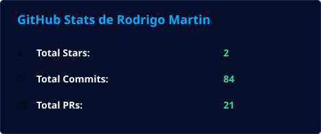
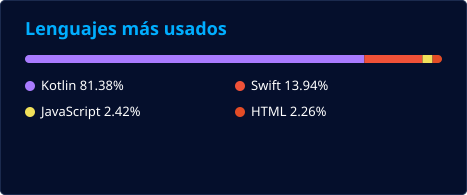

# 👋 ¡Hola! Soy Rodrigo

Ingeniero Android enfocado en Kotlin, Jetpack Compose, Clean Architecture, modularización,
rendimiento y calidad de código.

- 📱 Construyendo y mejorando aplicaciones móviles con foco en **arquitectura, rendimiento y
  experiencia de usuario**.
- 🍎 Navegando por **Swift** y explorando el desarrollo nativo en iOS.

---

## ⚙️ Tecnologías y herramientas

    
    
    
    
  

  

    
    
    
    
    
    
    
    
    
  

  

    <!-- ===================== HERRAMIENTAS ===================== -->
    
    
    
    
    
    
    
    

---

## 📈 GitHub Stats

---
